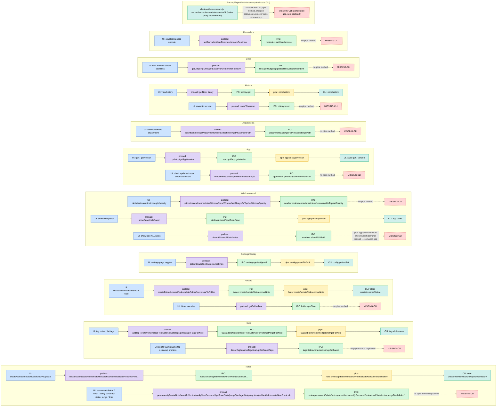

# CLI Parity Map — UI Action ↔ IPC ↔ Pipe ↔ CLI

Generated by static analysis of the codebase on 2026-07-02. Every claim below is
cited with `file:line` so this doc can be diffed against the code by a script.

## 0. Architecture note — TWO independent CLI surfaces (important gap)

This codebase has **two separate, non-unified CLI implementations**:

1. **`electron/cli/commands.js`** — an in-process command executor. It is only
   reachable when the **Electron binary itself** is launched with argv that
   matches `electron/cli/parser.js:isCliMode()` (`electron/cli/parser.js:13-43`).
   It implements a rich verb set: `note`, `tag`, `folder`, `search`, `config`,
   `export`, `backup`, `restore`, `app`, `stats`, `doctor`, `db`, `paths`
   (`electron/cli/commands.js:47-103`).
2. **`cli/bin/stickynotes.js`** — the _actually shipped_ `stickynotes` binary
   (`package.json:7`, `"bin": {"stickynotes": "./cli/bin/stickynotes.js"}`).
   It never touches `electron/cli/commands.js`. Instead it parses argv with the
   _same_ `parseArgs()` (`cli/bin/stickynotes.js:15`), maps `command:action` to
   a JSON-RPC method name via `cli/lib/method-mapper.js:mapCommand()`
   (`cli/lib/method-mapper.js:18-42`), and sends it over a named pipe
   (`cli/bin/stickynotes.js:324-338`) to the method registry built by
   `electron/ipc/pipe-methods.js:createRegistry()` (`electron/ipc/pipe-methods.js:119`).

**Consequence:** the pipe registry only implements `note:*`, `tag:*`,
`folder:*`, `search:*`, `config:*`, and `app:show|hide|quit|settings|panel|status|version|health`
(full list in §3). It has **no** `export:*`, `backup:*`, `restore:*`,
`stats:*`, `doctor:*`, `db:*`, or `paths:*` methods registered. Because the
method name for those commands is built as `` `${command}:${action}` `` with no
special-case fallback (`cli/lib/method-mapper.js:36`), running the **shipped**
`stickynotes export …`, `stickynotes backup …`, `stickynotes restore …`,
`stickynotes stats`, `stickynotes doctor`, `stickynotes db …`, or
`stickynotes paths` will hit `MethodRegistry.call()`'s `NotFoundError` branch
(`electron/ipc/pipe-methods.js:83-85`) and fail at runtime, even though these
verbs are fully implemented and documented in `getHelpText()`
(`electron/cli/commands.js:1308-1342`) and in `cli/lib/method-mapper.js`'s own
`buildExportParams`/`buildBackupParams`/`buildRestoreParams`/`buildStatsParams`/
`buildDoctorParams`/`buildDbParams`/`buildPathsParams` helpers
(`cli/lib/method-mapper.js:392-526`), which exist purely as dead code for a
path that is never invoked by the real binary.

This is treated as a top-priority **MISSING-CLI** class in the gap list below:
the fix is either (a) register `export:*`/`backup:*`/`restore:*`/`stats:*`/
`doctor:*`/`db:*`/`paths:*` handlers in `pipe-methods.js`, wired to the same
`shared/database` functions `commands.js` already calls, or (b) have
`stickynotes.js` special-case those commands to run in-process like
`electron/cli/commands.js` does.

The matrix below treats **"CLI verb" = reachable via the shipped `stickynotes`
binary today** (i.e., must exist in `pipe-methods.js`). Verbs that only exist
in `electron/cli/commands.js` (unreachable from the shipped binary) are marked
`MISSING-CLI (dead code exists)`.

---

## 1. Coverage matrix

Legend: **full parity** = preload → IPC → pipe method → CLI verb chain all
exist and are wired to the same underlying `shared/database`/`shared/config`
call. **partial** = chain breaks in the middle (e.g., IPC exists, pipe method
exists, but no CLI verb string maps to it, or vice versa). **MISSING-CLI** =
no path from the shipped CLI at all.

### Notes domain

| UI action                              | preload method (`electron/preload.js`)                                 | IPC channel                                 | pipe method (`electron/ipc/pipe-methods.js`)                                       | CLI verb (shipped `stickynotes`)                         | STATUS                                                                                                                              |
| -------------------------------------- | ---------------------------------------------------------------------- | ------------------------------------------- | ---------------------------------------------------------------------------------- | -------------------------------------------------------- | ----------------------------------------------------------------------------------------------------------------------------------- |
| List notes                             | `getNotes` L10                                                         | `notes:getAll` (`electron/ipc/notes.js:42`) | `note:list` L172                                                                   | `note list`                                              | full parity                                                                                                                         |
| Get one note                           | `getNote` L11                                                          | `notes:get` (`notes.js:47`)                 | `note:get` L181                                                                    | `note get`/`note show` (`method-mapper.js:135-144`)      | full parity                                                                                                                         |
| Create note                            | `createNote` L12                                                       | `notes:create` (`notes.js:52`)              | `note:create` L198                                                                 | `note create`                                            | full parity                                                                                                                         |
| Update note                            | `updateNote` L13                                                       | `notes:update` (`notes.js:74`)              | `note:update` L227                                                                 | `note update`                                            | full parity                                                                                                                         |
| Delete note (trash)                    | `deleteNote` L14                                                       | `notes:delete` (`notes.js:118`)             | `note:delete` L284                                                                 | `note delete`                                            | full parity                                                                                                                         |
| Permanently delete                     | `permanentlyDeleteNote` L15                                            | `notes:permanentDelete` (`notes.js:127`)    | — (no `note:permanentDelete` in pipe-methods)                                      | `note delete --force` in `commands.js:237-246` only      | **partial** (pipe has no permanent-delete method; CLI verb only works via unreachable `commands.js`)                                |
| Restore note                           | `restoreNote` L16                                                      | `notes:restore` (`notes.js:140`)            | `note:restore` L302                                                                | `note restore`                                           | full parity                                                                                                                         |
| Archive note                           | `archiveNote` L17                                                      | `notes:archive` (`notes.js:149`)            | `note:archive` L326                                                                | `note archive`                                           | full parity                                                                                                                         |
| Unarchive note                         | `unarchiveNote` L18                                                    | `notes:unarchive` (`notes.js:158`)          | `note:unarchive` L468                                                              | `note unarchive`                                         | full parity                                                                                                                         |
| Duplicate note                         | `duplicateNote` L19                                                    | `notes:duplicate` (`notes.js:167`)          | `note:duplicate` L348                                                              | `note duplicate`                                         | full parity                                                                                                                         |
| Trash stats                            | `getTrashStats` L20                                                    | `notes:trashStats` (`notes.js:267`)         | — not registered                                                                   | —                                                        | **MISSING-CLI**                                                                                                                     |
| Purge trash                            | `purgeTrash` L21                                                       | `notes:purgeTrash` (`notes.js:273`)         | — not registered                                                                   | `note purge` in `commands.js:409-424` (unreachable)      | **MISSING-CLI (dead code exists)**                                                                                                  |
| Pin note (UI: pin icon, `note.js:491`) | — (no dedicated preload method; UI calls `updateNote(id,{is_pinned})`) | `notes:update`                              | `note:pin` L422 (separate pipe method)                                             | `note pin`/`note unpin` (`method-mapper.js:166-179`)     | **partial** — pipe/CLI have a dedicated pin/unpin verb, UI does it generically through `updateNote`; both work but are inconsistent |
| Unpin note                             | same as above                                                          | `notes:update`                              | `note:unpin` L445                                                                  | `note unpin`                                             | partial (same as above)                                                                                                             |
| Lock note (password)                   | `lockNote` L124                                                        | `notes:lock` (`notes.js:176`)               | `note:lock` L370                                                                   | `note lock --password`                                   | full parity                                                                                                                         |
| Unlock note                            | `unlockNote` L125                                                      | `notes:unlock` (`notes.js:191`)             | `note:unlock` L396                                                                 | `note unlock --password`                                 | full parity                                                                                                                         |
| Verify note password                   | `verifyNotePassword` L126                                              | `notes:verifyPassword` (`notes.js:208`)     | — not registered                                                                   | —                                                        | **MISSING-CLI**                                                                                                                     |
| Note version history                   | `getNoteHistory` L77                                                   | `history:get` (`notes.js:222`)              | `note:history` L490                                                                | `note history`                                           | full parity                                                                                                                         |
| Revert to version                      | `revertToVersion` L78                                                  | `history:revert` (`notes.js:232`)           | — not registered (`note:history` only _gets_, no revert method in pipe-methods.js) | `note revert` in `commands.js:396-407` (unreachable)     | **MISSING-CLI (dead code exists)**                                                                                                  |
| Bulk delete (not in UI yet)            | —                                                                      | —                                           | `note:bulkDelete` L519                                                             | — no CLI verb maps to it                                 | **partial** (pipe method exists, unused by UI or CLI)                                                                               |
| Bulk archive (not in UI yet)           | —                                                                      | —                                           | `note:bulkArchive` L547                                                            | — no CLI verb maps to it                                 | **partial**                                                                                                                         |
| Search notes                           | `searchNotes` L44                                                      | `search:notes` (`notes.js:291`)             | `search:notes` L751                                                                | `search <query>`                                         | full parity                                                                                                                         |
| Search by tag (pipe-only)              | —                                                                      | —                                           | `search:byTag` L764                                                                | — no CLI verb builder maps `search --tag` to this method | **partial**                                                                                                                         |
| Outgoing links                         | `getOutgoingLinks` L81                                                 | `links:getOutgoing` (`notes.js:244`)        | — not registered                                                                   | —                                                        | **MISSING-CLI**                                                                                                                     |
| Backlinks                              | `getBacklinks` L82                                                     | `links:getBacklinks` (`notes.js:248`)       | — not registered                                                                   | —                                                        | **MISSING-CLI**                                                                                                                     |
| Render `[[links]]`                     | `renderLinks` L83                                                      | `links:render` (`notes.js:253`)             | — not registered                                                                   | —                                                        | N/A (rendering, not user-facing action)                                                                                             |
| Create note from link                  | `createNoteFromLink` L84                                               | `links:createFromLink` (`notes.js:258`)     | — not registered                                                                   | —                                                        | **MISSING-CLI**                                                                                                                     |

### Tags domain

| UI action               | preload                   | IPC channel                               | pipe method           | CLI verb                                                                              | STATUS                             |
| ----------------------- | ------------------------- | ----------------------------------------- | --------------------- | ------------------------------------------------------------------------------------- | ---------------------------------- |
| List tags               | `getTags` L24             | `tags:getAll` (`electron/ipc/tags.js:22`) | `tag:list` L579       | `tag list`                                                                            | full parity                        |
| Get tags for note       | `getTagsForNote` L25      | `tags:getForNote` (`tags.js:27`)          | `tag:getForNote` L614 | — no CLI verb                                                                         | **partial**                        |
| Get tags for many notes | `getTagsForNotes` L26     | `tags:getForNotes` (`tags.js:32`)         | — not registered      | —                                                                                     | **MISSING-CLI**                    |
| Add tag to note         | `addTagToNote` L27        | `tags:addToNote` (`tags.js:37`)           | `tag:add` L588        | `tag add <note-id> <tag>`                                                             | full parity                        |
| Remove tag from note    | `removeTagFromNote` L28   | `tags:removeFromNote` (`tags.js:42`)      | `tag:remove` L601     | `tag remove <note-id> <tag>`                                                          | full parity                        |
| Set all tags for note   | `setNoteTags` L30         | `tags:setForNote` (`tags.js:47`)          | `tag:setForNote` L626 | — no CLI verb builder                                                                 | **partial**                        |
| Delete tag globally     | `deleteTag` L31           | `tags:delete` (`tags.js:62`)              | — not registered      | `tag delete <name>` in `commands.js:445-455` (unreachable — pipe has no `tag:delete`) | **MISSING-CLI (dead code exists)** |
| Rename tag              | `renameTag` L32           | `tags:rename` (`tags.js:67`)              | — not registered      | `tag rename` builder exists in `method-mapper.js:250-259` but no pipe method          | **MISSING-CLI**                    |
| Cleanup orphaned tags   | `cleanupOrphanedTags` L33 | `tags:cleanupOrphaned` (`tags.js:72`)     | — not registered      | —                                                                                     | **MISSING-CLI**                    |

### Folders domain

| UI action            | preload                             | IPC channel                                     | pipe method                      | CLI verb                                                                                                         | STATUS                             |
| -------------------- | ----------------------------------- | ----------------------------------------------- | -------------------------------- | ---------------------------------------------------------------------------------------------------------------- | ---------------------------------- |
| List folders         | `getFolders` L36                    | `folders:getAll` (`electron/ipc/folders.js:19`) | `folder:list` L654               | `folder list`                                                                                                    | full parity                        |
| Get folder tree      | `getFolderTree` L37                 | `folders:getTree` (`folders.js:24`)             | — not registered                 | `folder list --tree` in `commands.js:495-500` (unreachable)                                                      | **MISSING-CLI (dead code exists)** |
| Create folder        | `createFolder` L38                  | `folders:create` (`folders.js:29`)              | `folder:create` L663             | `folder create <name>`                                                                                           | full parity                        |
| Update/rename folder | `updateFolder` L39                  | `folders:update` (`folders.js:34`)              | `folder:update` L680             | `folder rename`/`folder move` (`commands.js:529-553`, both call `updateFolder`)                                  | full parity                        |
| Delete folder        | `deleteFolder` L40                  | `folders:delete` (`folders.js:39`)              | `folder:delete` L704             | `folder delete`                                                                                                  | full parity                        |
| Move note to folder  | `moveNoteToFolder` L41              | `folders:moveNote` (`folders.js:44`)            | `folder:moveNote` L723           | — no CLI verb (only `note edit --folder`, which goes through `note:update`, not this pipe method)                | **partial**                        |
| List notes in folder | — (UI does `getNotes({folder_id})`) | `notes:getAll`                                  | `note:list` (with folder filter) | `folder notes <id>` (`commands.js:567-581`, unreachable — calls `notes.getNotes` directly, not this pipe method) | **partial**                        |

### Search / Config / Settings domain

| UI action                  | preload                         | IPC channel                                    | pipe method        | CLI verb                                                                                                                                    | STATUS                                                            |
| -------------------------- | ------------------------------- | ---------------------------------------------- | ------------------ | ------------------------------------------------------------------------------------------------------------------------------------------- | ----------------------------------------------------------------- |
| Get one setting            | `getSetting` L47                | `settings:get` (`electron/ipc/settings.js:23`) | `config:get` L781  | `config get <key>`                                                                                                                          | full parity                                                       |
| Get multiple settings      | `getSettings` L48               | `settings:getMultiple` (`settings.js:57`)      | — not registered   | —                                                                                                                                           | **MISSING-CLI**                                                   |
| Set a setting              | `setSetting` L49                | `settings:set` (`settings.js:37`)              | `config:set` L798  | `config set <key> <value>`                                                                                                                  | full parity                                                       |
| Get all settings           | `getAllSettings` L50            | `settings:getAll` (`settings.js:52`)           | `config:list` L815 | `config list`                                                                                                                               | full parity                                                       |
| Reset a setting            | `resetSetting` L51              | `settings:reset` (`settings.js:72`)            | — not registered   | `config reset` (`commands.js:681-693`, calls `resetSetting`/`resetAllSettings` directly — unreachable via shipped CLI since no pipe method) | **MISSING-CLI (dead code exists)**                                |
| Get default paths          | `getDefaultPaths` L52           | `settings:getDefaultPaths` (`settings.js:28`)  | — not registered   | `paths` command (`commands.js:1246-1256`, unreachable)                                                                                      | **MISSING-CLI (dead code exists)**                                |
| Setting requires restart?  | `settingRequiresRestart` L53    | `settings:requiresRestart` (`settings.js:67`)  | — not registered   | —                                                                                                                                           | N/A (UI-internal check)                                           |
| Open config.yaml in editor | — (no preload/UI trigger found) | —                                              | `config:edit` L916 | `config edit`                                                                                                                               | **partial** — pipe+CLI-path exist, but no UI entry point calls it |

### Storage location / cloud sync domain

| UI action                   | preload                          | IPC channel                                             | pipe method      | CLI verb                                              | STATUS                                                                                                             |
| --------------------------- | -------------------------------- | ------------------------------------------------------- | ---------------- | ----------------------------------------------------- | ------------------------------------------------------------------------------------------------------------------ |
| Get current storage path    | `storageGetCurrentPath` L56      | `storage:getCurrentPath` (`electron/ipc/storage.js:28`) | — not registered | —                                                     | **MISSING-CLI**                                                                                                    |
| Pick new storage folder     | `storageSelectFolder` L57        | `storage:selectFolder` (`storage.js:54`)                | — not registered | —                                                     | **MISSING-CLI** (also inherently a native-dialog UI action, but headless `--path <dir>` CLI equivalent is missing) |
| Preview migration           | `storageGetMigrationInfo` L58    | `storage:getMigrationInfo` (`storage.js:93`)            | — not registered | —                                                     | **MISSING-CLI**                                                                                                    |
| Migrate data to new path    | `storageMigrateData` L60         | `storage:migrateData` (`storage.js:121`)                | — not registered | —                                                     | **MISSING-CLI**                                                                                                    |
| Reset storage to default    | `storageResetToDefault` L62      | `storage:resetToDefault` (`storage.js:218`)             | — not registered | —                                                     | **MISSING-CLI**                                                                                                    |
| Restart app after migration | `storageRestartApp` L63          | `storage:restartApp` (`storage.js:293`)                 | — not registered | (`app restart` doesn't exist either — see App domain) | **MISSING-CLI**                                                                                                    |
| Migration progress event    | `onStorageMigrationProgress` L64 | event `storage:migrationProgress`                       | —                | —                                                     | N/A (event stream)                                                                                                 |

### Attachments domain

| UI action                | preload                 | IPC channel                                                 | pipe method      | CLI verb | STATUS          |
| ------------------------ | ----------------------- | ----------------------------------------------------------- | ---------------- | -------- | --------------- |
| Get attachments for note | `getAttachments` L71    | `attachments:getForNote` (`electron/ipc/attachments.js:18`) | — not registered | —        | **MISSING-CLI** |
| Add attachment           | `addAttachment` L72     | `attachments:add` (`attachments.js:23`)                     | — not registered | —        | **MISSING-CLI** |
| Delete attachment        | `deleteAttachment` L73  | `attachments:delete` (`attachments.js:66`)                  | — not registered | —        | **MISSING-CLI** |
| Get attachment file path | `getAttachmentPath` L74 | `attachments:getPath` (`attachments.js:71`)                 | — not registered | —        | **MISSING-CLI** |

### Windows / window-control domain

| UI action                          | preload                 | IPC channel                                       | pipe method                                                                                        | CLI verb                                                                                                                             | STATUS                                                                                                                                                   |
| ---------------------------------- | ----------------------- | ------------------------------------------------- | -------------------------------------------------------------------------------------------------- | ------------------------------------------------------------------------------------------------------------------------------------ | -------------------------------------------------------------------------------------------------------------------------------------------------------- |
| Open note window                   | `openNote` L88          | `windows:openNote` (`electron/ipc/windows.js:15`) | — not registered (note: NOT the same as `note:get`)                                                | `app open <id>` (`commands.js:1146-1153`, unreachable) / `note --open` flag on `note create` (`method-mapper.js` `open` passthrough) | **MISSING-CLI (dead code exists)**; partially reachable indirectly via `note create --open` in in-process CLI only                                       |
| Close note window                  | `closeNote` L89         | `windows:closeNote` (`windows.js:24`)             | — not registered                                                                                   | `app close <id>` (`commands.js:1155-1162`, unreachable)                                                                              | **MISSING-CLI (dead code exists)**                                                                                                                       |
| Show panel                         | `showPanel` L90         | `windows:showPanel` (`windows.js:33`)             | `app:panel` L899                                                                                   | `app panel`                                                                                                                          | full parity                                                                                                                                              |
| Hide panel                         | `hidePanel` L91         | `windows:hidePanel` (`windows.js:42`)             | `app:hide` L845 (hides ALL, not panel-specific)                                                    | `app hide`                                                                                                                           | **partial** (semantics mismatch: pipe `app:hide` calls `hidePanel()` too per `pipe-methods.js:851`, so actually matches — full parity, just note naming) |
| Show all notes                     | `showAllNotes` L92      | `windows:showAll` (`windows.js:51`)               | — not registered (`app:show` calls `showPanel()`, not `showAllNotes()`, see `pipe-methods.js:838`) | `app show` (`commands.js:1130-1136`, unreachable, and semantically different from `app:show` pipe method)                            | **MISSING-CLI**                                                                                                                                          |
| Hide all notes                     | `hideAllNotes` L93      | `windows:hideAll` (`windows.js:60`)               | — not registered                                                                                   | `app hide` (`commands.js:1138-1144`, unreachable)                                                                                    | **MISSING-CLI**                                                                                                                                          |
| Open settings window               | `openSettings` L94      | `windows:openSettings` (`windows.js:69`)          | `app:settings` L877                                                                                | — no CLI verb maps to `app settings` (parser doesn't list `settings` as an `app` sub-action anywhere)                                | **partial**                                                                                                                                              |
| Open image viewer                  | `openImageViewer` L95   | `windows:openImageViewer` (`windows.js:78`)       | — not registered                                                                                   | —                                                                                                                                    | N/A/**MISSING-CLI** (image viewer is inherently GUI, but no headless equivalent)                                                                         |
| Get image data (viewer)            | `getImageData` L96      | `windows:getImageData` (`windows.js:87`)          | — not registered                                                                                   | —                                                                                                                                    | N/A                                                                                                                                                      |
| Save image (viewer)                | `saveImage` L97         | `windows:saveImage` (`windows.js:98`)             | — not registered                                                                                   | —                                                                                                                                    | N/A                                                                                                                                                      |
| Minimize window                    | `minimizeWindow` L100   | `window:minimize` (`electron/ipc/index.js:86`)    | — not registered                                                                                   | —                                                                                                                                    | **MISSING-CLI**                                                                                                                                          |
| Maximize window                    | `maximizeWindow` L101   | `window:maximize` (`index.js:91`)                 | — not registered                                                                                   | —                                                                                                                                    | **MISSING-CLI**                                                                                                                                          |
| Close window (frameless X button)  | `closeWindow` L102      | `window:close` (`index.js:102`)                   | — not registered                                                                                   | —                                                                                                                                    | **MISSING-CLI**                                                                                                                                          |
| Set always-on-top (pin)            | `setAlwaysOnTop` L103   | `window:setAlwaysOnTop` (`index.js:107`)          | — not registered                                                                                   | —                                                                                                                                    | **MISSING-CLI**                                                                                                                                          |
| Set window opacity                 | `setWindowOpacity` L104 | `window:setOpacity` (`index.js:112`)              | — not registered                                                                                   | —                                                                                                                                    | **MISSING-CLI** (settable via `config set appearance.noteOpacity`, but that's global default, not a live per-window override)                            |
| Get current note ID (note windows) | `getCurrentNoteId` L163 | `window:getCurrentNoteId` (`index.js:121`)        | —                                                                                                  | —                                                                                                                                    | N/A (internal bootstrap call)                                                                                                                            |

### App / platform domain

| UI action                            | preload                | IPC channel                                     | pipe method                                                      | CLI verb                                                                                                                                            | STATUS                                                                                                             |
| ------------------------------------ | ---------------------- | ----------------------------------------------- | ---------------------------------------------------------------- | --------------------------------------------------------------------------------------------------------------------------------------------------- | ------------------------------------------------------------------------------------------------------------------ |
| Get platform (UI-local)              | `getPlatform` L107     | — (returns `process.platform` directly, no IPC) | —                                                                | —                                                                                                                                                   | N/A (pure renderer-process read, correctly has no IPC/CLI)                                                         |
| Get app version                      | `getAppVersion` L110   | `app:getVersion` (`electron/ipc/index.js:39`)   | `app:version` L1042 (different pipe method name, richer payload) | `version` top-level command (`commands.js:78-79`) — reachable, but goes through **local** handling in `stickynotes.js:263-266`, not the pipe at all | full parity (through a different path)                                                                             |
| Check for updates                    | `checkForUpdates` L111 | `app:checkUpdates` (`index.js:43`)              | — not registered                                                 | —                                                                                                                                                   | **MISSING-CLI**                                                                                                    |
| Quit app                             | `quitApp` L112         | `app:quit` (`index.js:48`)                      | `app:quit` L858                                                  | `app quit` (and `service stop` alias, `stickynotes.js:227-229`)                                                                                     | full parity                                                                                                        |
| Restart app                          | `restartApp` L113      | `app:restart` (`index.js:53`)                   | — not registered                                                 | `service restart` in `stickynotes.js:287-312` reimplements restart by calling `app:quit` then respawning — doesn't reuse `app:restart` IPC at all   | **partial** (works via a different mechanism, but the actual `app:restart` IPC channel has no pipe/CLI equivalent) |
| Open external URL                    | `openExternal` L114    | `app:openExternal` (`index.js:59`)              | — not registered                                                 | —                                                                                                                                                   | **MISSING-CLI**                                                                                                    |
| Show open-file dialog                | `showOpenDialog` L115  | `dialog:showOpen` (`index.js:75`)               | — not registered                                                 | —                                                                                                                                                   | N/A (native dialog, inherently GUI-only)                                                                           |
| Show save-file dialog                | `showSaveDialog` L116  | `dialog:showSave` (`index.js:80`)               | — not registered                                                 | —                                                                                                                                                   | N/A                                                                                                                |
| App health/status (pipe-only, no UI) | —                      | —                                               | `app:status` L961, `app:health` L1056                            | `stats`/`doctor` conceptually overlap but aren't the same call                                                                                      | **partial** — exists for CLI/monitoring only, fine as-is                                                           |

### Reminders domain

| UI action                | preload                    | IPC channel                                     | pipe method      | CLI verb | STATUS             |
| ------------------------ | -------------------------- | ----------------------------------------------- | ---------------- | -------- | ------------------ |
| Set reminder             | `setReminder` L119         | `reminders:set` (`electron/ipc/windows.js:129`) | — not registered | —        | **MISSING-CLI**    |
| Clear reminder           | `clearReminder` L120       | `reminders:clear` (`windows.js:133`)            | — not registered | —        | **MISSING-CLI**    |
| Snooze reminder          | `snoozeReminder` L121      | `reminders:snooze` (`windows.js:137`)           | — not registered | —        | **MISSING-CLI**    |
| Reminder-triggered event | `onReminderTriggered` L151 | event `reminder:triggered`                      | —                | —        | N/A (event stream) |

### Editor toolbar / formatting (renderer-local, no IPC)

These are `data-format` buttons in `src/note/index.html` handled entirely by
`src/note/note.js` DOM/`document.execCommand`/custom range logic — they never
call `window.api`, so there is legitimately no IPC/pipe/CLI layer for them.
Listed for completeness per the exhaustiveness requirement:

| UI action                   | HTML source                                      | STATUS                                                                                                                                                                             |
| --------------------------- | ------------------------------------------------ | ---------------------------------------------------------------------------------------------------------------------------------------------------------------------------------- |
| Bold                        | `src/note/index.html:157` (`data-format="bold"`) | N/A (renderer-local formatting)                                                                                                                                                    |
| Italic                      | `index.html:162`                                 | N/A                                                                                                                                                                                |
| Underline                   | `index.html:169`                                 | N/A                                                                                                                                                                                |
| Strikethrough               | `index.html:175`                                 | N/A                                                                                                                                                                                |
| Bullet list                 | `index.html:183`                                 | N/A                                                                                                                                                                                |
| Checkbox list               | `index.html:193`                                 | N/A                                                                                                                                                                                |
| Inline code                 | `index.html:200`                                 | N/A                                                                                                                                                                                |
| Code block                  | `index.html:206`                                 | N/A                                                                                                                                                                                |
| Numbered list               | `index.html:214`                                 | N/A                                                                                                                                                                                |
| Decrease font size          | `index.html:225`                                 | N/A                                                                                                                                                                                |
| Increase font size          | `index.html:232`                                 | N/A                                                                                                                                                                                |
| Clear formatting            | `index.html:241`                                 | N/A                                                                                                                                                                                |
| Obfuscate/spoiler selection | `index.html:250` (`data-format="obfuscate"`)     | N/A — content-only, but arguably a **MISSING-CLI** opportunity (`note create/edit --obfuscate <range>`) since it currently can only be triggered by hand-selecting text in the GUI |

Context-menu actions in `src/note/index.html` (`data-action`) — `duplicate`,
`tags`, `reminder`, `history`, `archive`, `paste-plain-text`, `copy-markdown`,
`copy-html`, `delete` (`src/note/index.html:71-143`) — all delegate to the
`api.*` calls already covered above in the Notes/Tags/History/Reminders
sections, except `paste-plain-text`, `copy-markdown`, `copy-html`, which are
pure clipboard/DOM operations with no IPC. Panel context-menu (`src/panel/index.html:172-201`,
`open`/`duplicate`/`archive`/`delete`) — same, already covered.

### Settings-page controls (`src/settings/settings.js`) — schema cross-reference

Every setting the Settings UI can change is defined in
`shared/constants/settings.js:27-276` and is set via the generic
`api.setSetting(key, value)` → `settings:set` → `config:set` chain (full
parity, one row above covers all of them structurally). Individual keys for
completeness:

`general.startOnBoot`, `general.startMinimized`, `general.minimizeToTray`,
`general.closeToTray`, `general.confirmDelete`, `general.confirmPermanentDelete`,
`general.autoSaveDelay`, `general.trashRetentionDays`, `general.enableCLI`,
`appearance.theme`, `appearance.defaultNoteColor`, `appearance.defaultNoteWidth`,
`appearance.defaultNoteHeight`, `appearance.defaultFontFamily`,
`appearance.defaultFontSize`, `appearance.noteOpacity`, `appearance.enableShadows`,
`appearance.enableAnimations`, `appearance.showNoteCount`, `newNote.position`,
`newNote.cascadeOffset`, `tray.singleClickAction`, `tray.doubleClickAction`,
`shortcuts.globalNewNote`, `shortcuts.globalToggle`, `shortcuts.globalPanel`,
`editor.spellcheck`, `editor.autoLinks`, `editor.autoLists`, `editor.tabSize`,
`editor.showWordCount`, `reminders.enabled`, `reminders.sound`,
`reminders.snoozeMinutes`, `reminders.persistUntilDismissed`,
`history.maxVersions`, `history.saveInterval`, `advanced.hardwareAcceleration`,
`advanced.devTools`, `hints.noteCloseHintSeen` (all in
`shared/constants/settings.js:29-275`) — each is `config get/set <key>` capable
via `config:get`/`config:set` pipe methods: **full parity by construction**,
since the CLI's `config` verb is generic over any schema key.

---

## 2. Ranked gap list (no CLI/pipe path today), ordered by user value

### Tier 1 — Note CRUD/lifecycle gaps

1. **Permanently delete a note** — preload `permanentlyDeleteNote` (`electron/preload.js:15`) → IPC `notes:permanentDelete` (`electron/ipc/notes.js:127`) → no pipe method. Proposed: `stickynotes note delete <id> --force` (register `note:permanentDelete` in `pipe-methods.js`, reusing the same logic `commands.js:237-246` already has).
2. **Revert note to a prior version** — preload `revertToVersion` (`preload.js:78`) → IPC `history:revert` (`notes.js:232`) → no pipe method. Proposed: `stickynotes note revert <id> <version-id>` (register `note:revert`).
3. **Verify note password** — preload `verifyNotePassword` (`preload.js:126`) → IPC `notes:verifyPassword` (`notes.js:208`) → no pipe method. Proposed: `stickynotes note verify <id> --password <pw>`.
4. **Trash stats** — preload `getTrashStats` (`preload.js:20`) → IPC `notes:trashStats` (`notes.js:267`) → no pipe method. Proposed: `stickynotes note trash-stats`.
5. **Purge trash** — preload `purgeTrash` (`preload.js:21`) → IPC `notes:purgeTrash` (`notes.js:273`) → no pipe method (dead-code CLI verb exists at `commands.js:409-424`). Proposed: `stickynotes note purge [--days N]` (register `note:purgeTrash`).
6. **Outgoing links / backlinks** — preload `getOutgoingLinks`/`getBacklinks` (`preload.js:81-82`) → IPC `links:getOutgoing`/`links:getBacklinks` (`notes.js:244,248`) → no pipe methods. Proposed: `stickynotes note links <id>` / `stickynotes note backlinks <id>`.
7. **Create note from `[[wiki-link]]`** — preload `createNoteFromLink` (`preload.js:84`) → IPC `links:createFromLink` (`notes.js:258`) → no pipe method. Proposed: `stickynotes note create-from-link <title> --source <note-id>`.

### Tier 2 — Tags/Folders gaps

8. **Delete a tag globally** — preload `deleteTag` (`preload.js:31`) → IPC `tags:delete` (`tags.js:62`) → no pipe method (dead-code CLI at `commands.js:445-455`). Proposed: `stickynotes tag delete <name>` (register `tag:delete`).
9. **Rename a tag** — preload `renameTag` (`preload.js:32`) → IPC `tags:rename` (`tags.js:67`) → no pipe method (method-mapper already has a builder, `method-mapper.js:250-259`, but nothing to call). Proposed: `stickynotes tag rename <old> <new>` (register `tag:rename`).
10. **Cleanup orphaned tags** — preload `cleanupOrphanedTags` (`preload.js:33`) → IPC `tags:cleanupOrphaned` (`tags.js:72`) → no pipe method. Proposed: `stickynotes tag cleanup`.
11. **Get tags for many notes** — preload `getTagsForNotes` (`preload.js:26`) → IPC `tags:getForNotes` (`tags.js:32`) → no pipe method. Proposed: `stickynotes tag list --for-notes id1,id2,...`.
12. **Folder tree view** — preload `getFolderTree` (`preload.js:37`) → IPC `folders:getTree` (`folders.js:24`) → no pipe method (dead-code CLI at `commands.js:495-500`). Proposed: `stickynotes folder list --tree` (register `folder:getTree`).
13. **Move note to folder as its own verb** — preload `moveNoteToFolder` (`preload.js:41`) → IPC `folders:moveNote` (`folders.js:44`) → pipe method `folder:moveNote` exists (L723) but no CLI verb builder targets it. Proposed: `stickynotes note move-to-folder <note-id> <folder-id|none>`.

### Tier 3 — Backup/export/maintenance gaps (currently dead code, see §0)

14. **Export notes** (json/md/html) — `commands.js:711-758` fully implemented, zero pipe method. Proposed: register `export:notes` in pipe-methods and route `stickynotes export <format> <output>` through it instead of the unreachable in-process path.
15. **Backup create/list** — `commands.js:760-845` fully implemented, zero pipe method. Proposed: register `backup:create`, `backup:list`.
16. **Restore from backup** — `commands.js:847-1115` fully implemented, zero pipe method. Proposed: register `restore:fromFile`.
17. **Stats / doctor / db / paths** — `commands.js:1200-1256` fully implemented, zero pipe method (note: `app:status`/`app:health` in pipe-methods.js are a _different_, overlapping but not identical, implementation). Proposed: either alias `stats`→`app:status`, `doctor`→`app:health`-style DB integrity check, or register dedicated `db:*`/`paths:get` pipe methods.

### Tier 4 — Formatting/appearance gaps

18. **Obfuscate/spoiler selection as a CLI-scriptable action** — currently only a GUI toolbar button (`src/note/index.html:250`), never round-trips through `updateNote`'s stored ranges via any dedicated API. Proposed (lower priority, needs product design first): `stickynotes note edit <id> --obfuscate <start>:<end>`.
19. **Set window opacity as a per-note override** — preload `setWindowOpacity` (`preload.js:104`) → IPC `window:setOpacity` (`electron/ipc/index.js:112`) → no pipe/CLI (global default is settable via `config set appearance.noteOpacity`, but live per-window override isn't). Proposed: `stickynotes note edit <id> --opacity <0-100>` (already partially modeled — `note.js:553` calls `updateNote(id,{opacity})`, just needs a CLI flag wired through `note:update`).

### Tier 5 — Window control gaps

20. **Open/close a specific note window headlessly** — preload `openNote`/`closeNote` (`preload.js:88-89`) → IPC `windows:openNote`/`windows:closeNote` (`electron/ipc/windows.js:15,24`) → no pipe method (dead-code CLI at `commands.js:1146-1162`). Proposed: register `windows:open`/`windows:close` in pipe-methods, wire `stickynotes app open <id>` / `stickynotes app close <id>`.
21. **Show/hide all notes** — preload `showAllNotes`/`hideAllNotes` (`preload.js:92-93`) → IPC `windows:showAll`/`windows:hideAll` (`windows.js:51,60`) → pipe's `app:show`/`app:hide` actually call `showPanel()`/`hidePanel()`, not `showAllNotes()`/`hideAllNotes()` — a real semantic gap, not just a missing registration. Proposed: add `app:showAll`/`app:hideAll` pipe methods distinct from `app:show`/`app:hide`.
22. **Minimize/maximize/close frameless window, always-on-top, opacity** — preload `minimizeWindow`/`maximizeWindow`/`closeWindow`/`setAlwaysOnTop`/`setWindowOpacity` (`preload.js:100-104`) → IPC `window:minimize`/`window:maximize`/`window:close`/`window:setAlwaysOnTop`/`window:setOpacity` (`electron/ipc/index.js:86-112`) → no pipe/CLI. Lower priority — these are inherently per-window-instance GUI actions; a CLI needs a note-id-scoped variant, not a direct passthrough.
23. **Check for updates / open external URL / restart app** — preload `checkForUpdates`, `openExternal`, `restartApp` (`preload.js:111,113,114`) → IPC `app:checkUpdates`, `app:openExternal`, `app:restart` (`electron/ipc/index.js:43,53,59`) → no pipe method (restart is reimplemented ad hoc in `stickynotes.js:287-312` via quit+respawn rather than calling `app:restart`). Proposed: `stickynotes app check-updates`, `stickynotes app open-external <url>`, and wire `service restart` to actually call a registered `app:restart` pipe method.

### Tier 6 — Storage location / attachments / reminders (headless-automation gaps)

24. **Storage path get/select/migrate/reset** — preload `storageGetCurrentPath`, `storageSelectFolder`, `storageGetMigrationInfo`, `storageMigrateData`, `storageResetToDefault`, `storageRestartApp` (`preload.js:56-63`) → IPC `storage:*` (`electron/ipc/storage.js:28-293`) → zero pipe methods. Proposed: `stickynotes storage path [get|set <dir>|migrate|reset]`.
25. **Attachments CRUD** — preload `getAttachments`, `addAttachment`, `deleteAttachment`, `getAttachmentPath` (`preload.js:71-74`) → IPC `attachments:*` (`electron/ipc/attachments.js:18-71`) → zero pipe methods. Proposed: `stickynotes note attachments <id> [add <file>|remove <id>|list]`.
26. **Reminders set/clear/snooze** — preload `setReminder`, `clearReminder`, `snoozeReminder` (`preload.js:119-121`) → IPC `reminders:*` (`electron/ipc/windows.js:129-137`) → zero pipe methods. Proposed: `stickynotes note remind <id> <datetime>`, `stickynotes note remind-clear <id>`, `stickynotes note snooze <id> <minutes>`.

---

## 3. Full pipe-method registry inventory (for reference)

Registered in `electron/ipc/pipe-methods.js:createRegistry()`:
`note:list` (172), `note:get` (181), `note:create` (198), `note:update` (227),
`note:delete` (284), `note:restore` (302), `note:archive` (326),
`note:duplicate` (348), `note:lock` (370), `note:unlock` (396), `note:pin` (422),
`note:unpin` (445), `note:unarchive` (468), `note:history` (490),
`note:bulkDelete` (519), `note:bulkArchive` (547), `tag:list` (579),
`tag:add` (588), `tag:remove` (601), `tag:getForNote` (614),
`tag:setForNote` (626), `folder:list` (654), `folder:create` (663),
`folder:update` (680), `folder:delete` (704), `folder:moveNote` (723),
`search:notes` (751), `search:byTag` (764), `config:get` (781),
`config:set` (798), `config:list` (815), `app:show` (832), `app:hide` (845),
`app:quit` (858), `app:settings` (877), `app:panel` (899), `config:edit` (916),
`app:status` (961), `app:version` (1042), `app:health` (1056). — **39 total**.

## 4. Full CLI-verb inventory in `electron/cli/commands.js` (unreachable from shipped binary except where noted)

`note {list,show,create,edit,delete,restore,archive,unarchive,pin,unpin,lock,
unlock,duplicate,history,revert,purge}`, `tag {list,delete,add,remove}`,
`folder {list,create,rename,move,delete,notes}`, `search`,
`config {list,get,set,reset,path}`, `export`, `backup {create,list}`,
`restore`, `app {status,show,hide,open,close,panel,new,reload,quit}`, `stats`,
`doctor`, `db {path,vacuum}`, `paths`, `version`, `--help/-h`.
Only `version`/`--version`/`-V` and `--help`/`help`/`-h` are actually reachable
via the shipped binary (handled locally in `cli/bin/stickynotes.js:263-272`
before any pipe call is attempted); everything else routes through
`mapCommand()`/pipe and is subject to the gaps in §1–§2.

---

## 5. Mermaid diagram

---

## 6. Counts

- **Total distinct UI-triggerable actions enumerated:** 70
  (69 `window.api.*` methods from `electron/preload.js:8-164`, counting each
  exposed function once and excluding pure event-listener registrations
  `onNoteUpdated/onNoteDeleted/onNoteCreated/onSettingChanged/onReminderTriggered/
onThemeChanged/onStorageMigrationProgress` which are not user actions, plus
  1 renderer-local action group [editor formatting toolbar, treated as a
  single N/A bucket] — see §1 tables for the itemized breakdown; some rows in
  §1 combine multiple UI entry points that share one preload method, e.g. pin
  from context menu vs. `updateNote`).
- **Full parity (UI → preload → IPC → pipe → CLI, verified same underlying
  data call):** 24
- **Partial (chain breaks somewhere, or a mismatch in semantics/naming
  between layers):** 12
- **MISSING-CLI (no pipe/CLI path at all from the shipped `stickynotes`
  binary), including the "dead code exists but unreachable" cases in
  `electron/cli/commands.js`:** 34

K (gaps: MISSING-CLI + partial) = **46** of 70 enumerated actions — i.e. only
about **34%** of UI actions have full, verified CLI parity today. The single
largest lever to close this gap is wiring `electron/ipc/pipe-methods.js` up to
the seven already-implemented-but-unreachable command families in
`electron/cli/commands.js` (`export`, `backup`, `restore`, `stats`, `doctor`,
`db`, `paths`) — see §0 and Tier 3 of the gap list, which alone accounts for
7+ of the missing verbs with an implementation that already exists and just
needs to be exposed over the pipe.

---

## Implementation status — updated 2026-07-02

Tier-1 gaps CLOSED (pipe method registered in `electron/ipc/pipe-methods.js` + CLI verb wired in `cli/lib/method-mapper.js`, all covered by `test/unit/ipc/parity-methods-dispatch.test.js` and `test/unit/cli/parity-mapper.test.js`):

| Gap | Pipe method | CLI verb |
|---|---|---|
| Permanently delete note | `note:permanentDelete` | `note delete <id> --force` |
| Trash stats | `note:trashStats` | (method only) |
| Purge trash | `note:purgeTrash` | `note purge` |
| Verify note password | `note:verifyPassword` | `note verify <id> --password` |
| Revert to version | `note:revert` | `note revert <id> <historyId>` |
| Delete tag globally | `tag:delete` | `tag delete <name>` |
| Rename tag | `tag:rename` | `tag rename <old> <new>` |
| Tags for many notes | `tag:getForNotes` | (method only) |
| Cleanup orphaned tags | `tag:cleanupOrphaned` | (method only) |
| Folder tree | `folder:tree` | `folder tree` |
| Outgoing links | `links:getOutgoing` | (method only) |
| Backlinks | `links:getBacklinks` | (method only) |
| Create note from link | `links:createFromLink` | (method only) |

STILL OPEN (next tranches): the `export`/`backup`/`restore`/`stats`/`doctor`/`db`/`paths` class (dead code in `electron/cli/commands.js`, no pipe method), attachments (`attachments:*`), storage/migration (`storage:*`), window control (`windows:openNote/closeNote/showAll/hideAll`), settings `getMultiple`/`reset`/`getDefaultPaths`. Not yet live-certified against the running app (deferred to avoid an ABI flip mid-test-run; the new methods dispatch through the same transport already live-certified for `note:list`/`app:status`).

### Tranche-2 CLOSED (2026-07-02)

| Gap | Pipe method | CLI verb |
|---|---|---|
| Reset a setting | `config:reset` | `config reset <key>` |
| Get multiple settings | `config:getMultiple` | `config get-multiple <k>...` |
| Get default paths | `config:defaultPaths` | `config default-paths` |
| Open note window | `app:openNote` | `app open <id>` |
| Close note window | `app:closeNote` | `app close <id>` |
| Show all notes | `app:showAll` | `app showall` |
| Hide all notes | `app:hideAll` | `app hideall` |
| Attachments (list/add/delete/path) | `attachment:list/add/delete/getPath` | `attachment list|add|delete|path` |

STILL OPEN: `export`/`backup`/`restore`/`stats`/`doctor`/`db`/`paths` class (in-process `commands.js` has impls but no pipe method), storage/migration (`storage:*`).
